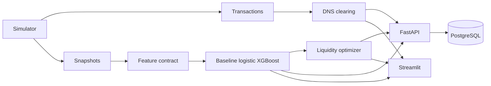

# Architecture

Smart Clearing & Settlement Engine is a single Python package. Each module owns one boundary. The clearing engine does not import the model. The optimizer does not receive settlement positions and cannot rewrite them.



## Clearing

`clear_cycle` is a pure function.

1. Duplicate transaction ids reject the whole submission.
2. Non-positive amounts, same-bank records, other cycles, other currencies, pending records, and malformed reversals are quarantined. The first matching rule wins.
3. A cleared purchase adds an issuer-to-acquirer obligation.
4. A reversed record adds the opposite obligation. It is not a new purchase. The original does not have to be in the same batch.
5. Bilateral flows in both directions are netted.
6. A participant's net position is gross credit minus gross debit.
7. `enforce_zero_sum` raises `ReconciliationError` unless net positions sum to 0, gross debit equals gross credit, and both equal the bilateral total.

Output order is sorted, so the same records in any order produce the same report. Amounts stay Python integers.

## Time and labels

Each simulated weekday cycle has a prediction timestamp at 14:00 UTC and a cutoff at 17:00 UTC.

| Question | Data used |
| --- | --- |
| Feature volumes | Eligible records with `event_timestamp <= prediction` |
| Forecast debit | Those volumes scaled by a fixed intraday prior |
| Historical shortfall rate | Earlier cycles only |
| Liquidity feature | Drawn from expected volume before the cycle's transactions are consulted |
| Label | Net debit at cutoff compared with liquidity at cutoff |

A shortfall is `net_debit > liquidity_at_cutoff`. Equality is sufficient. Creditors have a net debit of zero.

The label is computed by running the same clearing engine on the cutoff slice. It is not copied from a feature. Funding shocks can lower cutoff liquidity after prediction time; that shocked balance is not a model feature.

## Model selection

Cycles are split in time. Every bank in a cycle stays in the same split. The logistic scaler is fit on the training cycles only. Thresholds maximize validation F1, with ties keeping the lower threshold. Isotonic calibration is kept only when a later slice of the validation cycles improves Brier score. The selected approach is the best validation F1, then the simpler model. Test metrics are computed once for the comparison table and are not used to choose the threshold or the model.

## Optimizer

Reported cost is `funding_minor * cost_bps // 10000`.

The risk-informed policy minimizes that charge plus a penalty on uncovered requirement. The penalty is larger than any allowed basis-point cost and increases with the predicted probability, so a scarce portfolio cap prefers the bank with the higher score. The penalty is not a cash cost. Funding cannot be negative, cannot exceed the per-bank limit, and cannot exceed the gap to the policy requirement. If the cap or the limit leaves a gap, `unresolved_risk` is true.

`no_buffer`, `fixed_percentage`, and `rules_based` are closed-form comparisons. Only the risk-informed policy applies the portfolio cap. A predicted probability does not guarantee the realized shortfall rate.

## API state

```text
open -> cleared -> predicted -> optimized
```

| Transition | Rule |
| --- | --- |
| Ingest | New ids only while the cycle is open. Identical replay is a no-op. A changed payload conflicts. |
| Clear | Persists positions once. A later call returns the same obligations and does not insert them again. |
| Predict | Requires a cleared cycle. The first snapshot payload is kept. A different payload conflicts. |
| Optimize | Requires stored predictions. Does not update `net_positions`. |

Audit rows are written for ingestion, clearing, prediction, and optimization.

PostgreSQL is the application database, created by Docker Compose. SQLite is refused unless `SCSE_ALLOW_SQLITE=1`, which the automated tests set explicitly.

## Dashboard

`build_cycle_view` calls the clearing engine, the scorer, and the optimizer. Streamlit renders that view. The position chart divides minor units by 100 for a two-decimal display axis; the tables use `format_minor_units`. The page states that recommendations were not executed.
